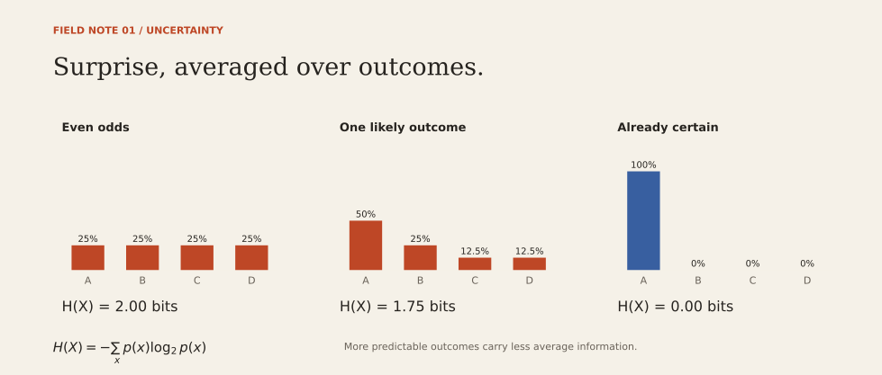
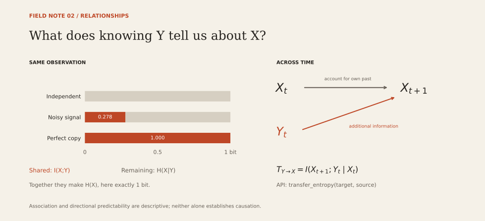

# How EntroPy measures a signal

An observation is a row. A state is a tuple of that row's values. EntroPy
counts states and divides by the number of observations to obtain an empirical
probability distribution. All logarithms use base 2; all results are in bits.

## Uncertainty

Shannon entropy is `H(X) = -sum p(x) log2 p(x)`. Zero-probability terms
contribute zero. A constant variable has zero entropy; four equally likely
states have two bits. Entropy is a lower bound on average binary code length.
An optimal sequence of yes/no questions need not attain that bound exactly
for an individual symbol with arbitrary probabilities.

## Relationships

| Measure | Definition | Interpretation |
| --- | --- | --- |
| Joint entropy | `H(X,Y)` | Uncertainty of the paired state |
| Conditional entropy | `H(X|Y) = H(X,Y) - H(Y)` | Uncertainty in X remaining after observing Y |
| Mutual information | `I(X;Y) = H(X) + H(Y) - H(X,Y)` | Information shared by the two variables |
| Transfer entropy | `I(X[t];Y[t-lag] | X[t-lag])` | Information from Y's past about X, beyond X's own past |

Paired functions require equal lengths and identical indexes in the same order.
They never silently align, drop, or impute observations. Input columns may have
the same names across different frames; internally they receive unique positions.
Multiple columns in an input form a joint state, including for transfer entropy.

Transfer entropy takes **target first, source second**. Rows must already be in
chronological order at regular intervals. `lag` is measured in rows. This is a
single-history-state estimator; it does not automatically select lag or embed
multiple history steps. A date index is accepted but is not sorted or resampled.
Bins are fitted to each full series before shifting, so the same value has the
same meaning in its past and future slices.

## Distribution drift

Cross-entropy uses `H(P,Q) = -sum p(x) log2 q(x)`.
KL divergence uses `D_KL(P||Q) = sum p(x) log2(p(x)/q(x))`.
P is the current/observed sample, Q is the reference. The sample lengths and row
indexes may differ; columns correspond by position. The audit command selects
reference columns by name before comparing them.

KL is directional, not a distance metric. If P observes a state absent in Q,
cross-entropy and KL return positive infinity. The audit JSON represents this
as `null` with `status: "unseen_in_reference"`, rather than emitting invalid
JSON or silently adding smoothing. States found only in Q do not create infinity.

## Discretization and missing data

`bins=None` preserves discrete values. With a positive integer `bins`, numeric
columns use equal-width bins; strings, categorical columns, and booleans retain
their original symbols. For cross-entropy and KL, bin edges are fitted to the
pooled P and Q samples. Corresponding columns must have compatible numeric types.
Empty bins are omitted, so calculations never evaluate `0 * log2(0)`.

For paired statistics, each variable has its own bins fitted to the current
data. Consequently the entropy associated with a drift comparison can differ
from a standalone entropy with independently fitted bins. The identity
`H(P,Q) = H(P) + D_KL(P||Q)` requires the **same discretization** in all terms.
Increasing the number of bins changes the question and often increases sampling
bias. To keep bin edges fixed across repeated audits, discretize externally and
pass categorical codes with `bins=None`.

Empty inputs, missing values, nonfinite numbers, duplicate input column names,
invalid bins, and incompatible paired indexes raise an error. Clean data
explicitly first; dropping observations can alter a distribution or a time lag.

## Interpretation limits

These are empirical plug-in estimates. They do not supply bias correction,
confidence intervals, permutation tests, or evidence of causation. A unique row
identifier can appear perfectly informative in a finite sample; it should not
be treated as a useful predictor. Individual feature rankings miss interactions
(for example, XOR) and do not measure a feature's incremental value given other
features. Validate associations on held-out data and investigate leakage.

The audit compares marginal distributions. A change in dependence between
columns can leave all marginals unchanged. Zero marginal KL does not prove that
the whole data distribution is stable. The bundled example is synthetic and
demonstrates known relationships; it is not a model performance benchmark.

## References and visual direction

### Browser workbench and Sam's historical sample

The original `resources/stock_prices/stock_prices_750.txt` contains 1,009 dates
and 724 price series. The small browser example uses MSFT, AMZN, IBM, CAT, DE,
and F. Each column is converted to fractional daily price change with no
forward-fill; rows with a missing change in any selected series are excluded.
The resulting 1,004 rows span 2013-12-03 through 2017-12-01. Changes below
−0.005 are "down", above +0.005 are "up", and the rest are "flat". The first
502 observations are the reference; the final 502 are current. The derived
categorical sample is packaged as `information/data/stock-demo.csv` so the UI
also works from an installed wheel. This is same-day association, not a
forecast, causal test, or complete audit of the original data provider.

The web layer parses bounded CSV inputs and calls the same `audit()` function
as the CLI. It listens only on loopback, accepts its own origin, and stores
neither uploads nor results. Downloads are explicitly initiated by the user.
The source dataset's original provenance/price adjustment policy is unknown;
the example is retained as an exploration of Sam's work.

The UI adapts the typographic hierarchy and open layout of
[HTML5 UP's Editorial reference](https://html5up.net/editorial), alongside the
direct chart labeling discussed below. Its markup and styling are original.

- [SciPy's entropy reference](https://docs.scipy.org/doc/scipy/reference/generated/scipy.stats.entropy.html): definitions of entropy, KL, and cross-entropy; used as an independent numerical test oracle.
- [Schreiber, Measuring Information Transfer (2000)](https://arxiv.org/abs/nlin/0001042): transfer entropy and conditioning on a target's history.
- [The Pudding's country-radio essay](https://pudding.cool/2023/05/country-radio/): reference for an editorial progression from a concrete question to directly labeled evidence.
- [Matplotlib's horizontal bar example](https://matplotlib.org/stable/gallery/lines_bars_and_markers/barh.html): standard statistical chart composition.

The new figures use original plotting code: paper background, serif titles,
simple rules, and orange/blue with direct text labels. No template code, fonts,
or illustrations were copied. PNGs are provided for previews; SVGs retain
editable vector shapes and text. Regenerate all three with
`python scripts/render_graphics.py`.

## Guided weather and explanations

The weather adapter requests 90 days of hourly ERA5 reanalysis estimates from
[Open-Meteo's historical API](https://open-meteo.com/en/docs/historical-weather-api),
ending seven days before the server's current date. Six fixed city coordinates
are supported; users cannot supply an arbitrary fetch URL. The first 45 days
are reference and the last 45 are current. Dates/hours use UTC. All 2,160 hours
must be present, finite, consecutive, ordered, and within basic physical bounds;
an incomplete response fails visibly rather than inventing values. Requests
have a 15-second timeout, 1 MB response limit, and 30-minute in-memory cache.
These are model-based estimates, not station observations or a forecast.

Rain is liquid rainfall >=0.1 mm/hour. Categories use fixed boundaries shared
by both periods: cloud cover at 25/75%, humidity at 40/70%, temperature at
10/20°C, wind at 10/25 km/h, sea-level pressure at 1010/1020 hPa. Boundary values
enter the upper category. Snow is not rain. Definitions, requested/fetched dates,
source link and CC BY 4.0 attribution are exposed in the UI and saved report.
The free endpoint's service terms are for non-commercial use; hosting or
commercialization needs its own access/terms decision.

Plain-language examples are deterministic counts from the same prepared data
used for mutual information, not generated assertions. A supported feature state
(at least 5 rows and 5% of the sample) with the largest absolute event-rate
change is shown. It is selected for illustration, not an independent validation
sample. Bars show I(target; clue)/H(target), with zero for a constant target.
Percentages are uncertainty reduction, never prediction accuracy. Individual
associations can overlap and must not be added together.

The shuffle experiment permutes one clue with seed 7, preserving its marginal
counts and the target while changing their row pairings. It calls the same Python
entropy implementation. One shuffle is a teaching comparison, not a permutation
significance test, and destroys temporal ordering. Adjacent weather hours and
stock days are dependent; no forecast or causal claim follows from these results.

The browser machine lesson reuses the CLI's known factorial construction but
renames fields, maps fault/healthy to broken/working, and omits the constant
batch column. The underlying library and CLI keep their existing field names.
The guided progression also draws on [The Pudding's climate-zones essay](https://pudding.cool/2024/06/climate-zones/):
a recognizable question before the measurements. No reference assets were copied.
