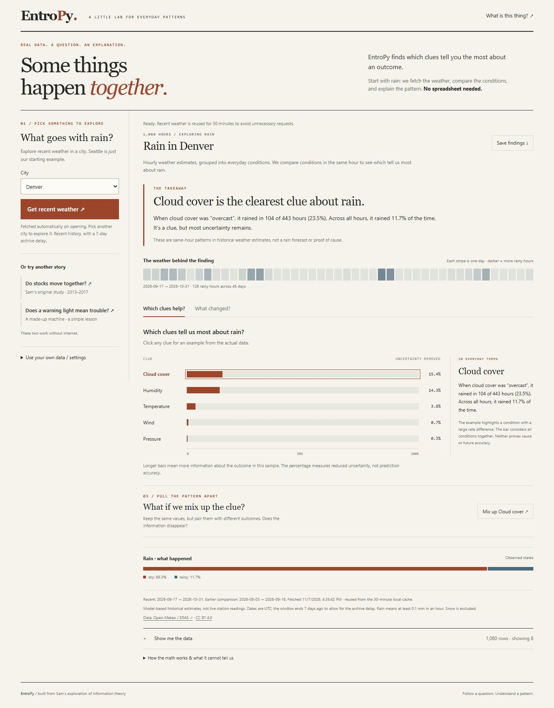
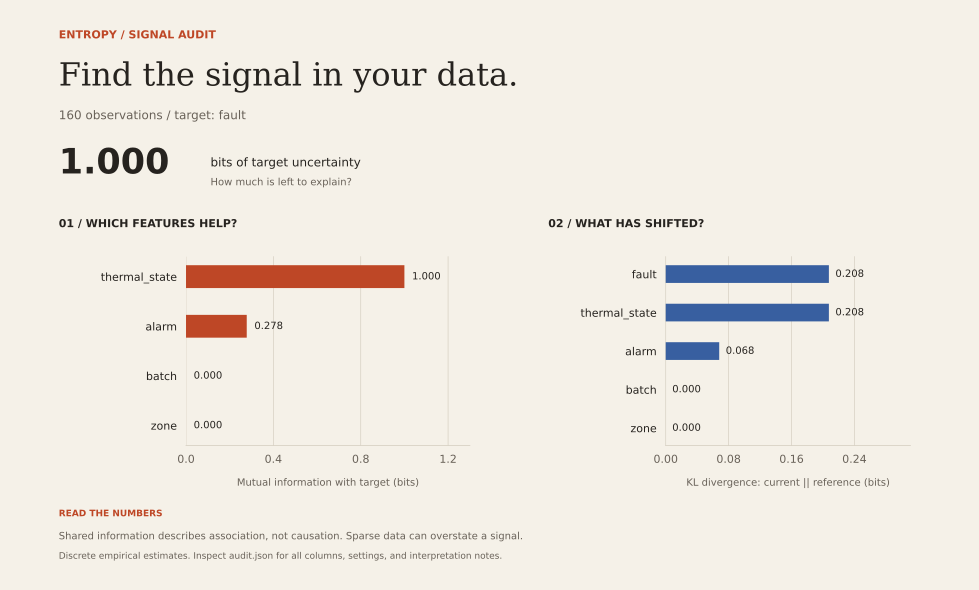
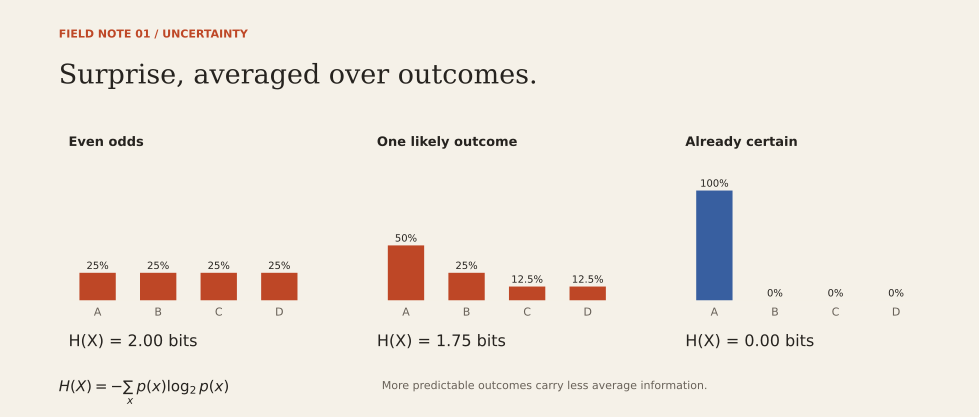
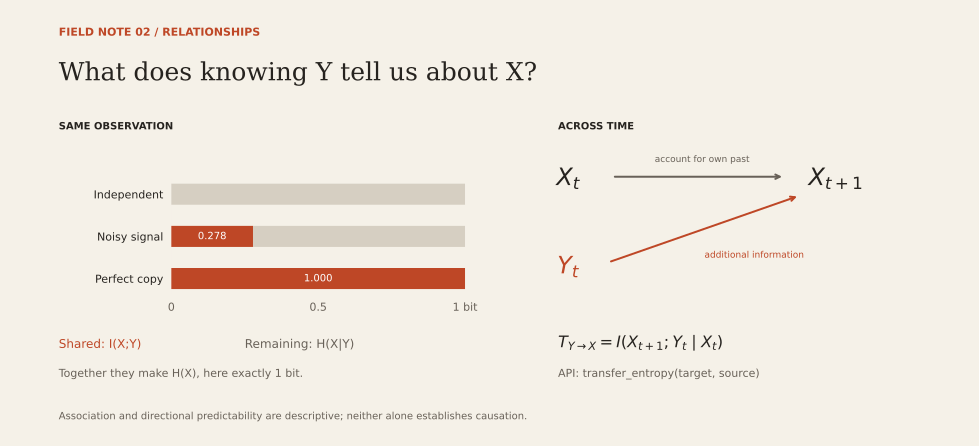

# EntroPy

**Explore what information can tell you—with data already included.**

A local, interactive continuation of Sam's entropy lessons and time-series
experiments. Pick a city or a built-in story, read a concrete finding, and mix
up a clue to discover why information depends on how observations line up.
The Python library also measures uncertainty, ranks feature associations, and
compares current and reference samples through its CLI and API.

## Open the browser workbench

Requires **Python 3.10+** (3.12 recommended). No API keys or spreadsheets needed.

```sh
git clone --branch feature/jw-1 https://github.com/wirsingj/EntroPy.git
cd EntroPy
python run.py
```

Use `python3` on macOS/Linux if needed. The launcher sets up `.venv` and opens
**http://127.0.0.1:8765**. Keep the terminal open; **Ctrl+C** stops the app.
First setup needs internet. See the **[local run guide and three-minute demo](docs/LOCAL_DEMO.md)**
for manual setup, troubleshooting, and a walkthrough to share with Sam.

- **What goes with rain?** Automatically fetch recent historical weather for
  six cities. See the strongest clue, rainy-hour counts, dates, and source.
- **Does a warning light mean trouble?** Learn from a fictional machine with a
  perfect temperature clue, an imperfect warning light, and an irrelevant room.
- **Do stocks move together?** Explore six companies from Sam's original data,
  with company names and explanations instead of unexplained ticker symbols.
- **Mix up a clue.** Compare original and shuffled pairs while keeping each
  variable's counts unchanged. Watch shared information change.

Stock and machine stories work offline. The weather source is Open-Meteo/ERA5;
its model-based archive ends seven days ago, and requests are cached for 30 minutes.
Explanations are calculated from the data; no AI API or generated predictions.
CSV uploads remain optional under settings (3 MB, 50,000 rows, 60 columns).
They stay local and are not saved by the server. Findings export includes source
metadata; the CLI supports larger offline analyses.



The stock example comes from Sam's original bundled price history, using six
symbols from 2013–2017. It compares **same-day** daily moves, categorized as
down below −0.5%, up above +0.5%, or flat otherwise. It explores historical
relationships; it does not predict returns. See the [methods guide](docs/methods.md)
for the sample's transformation and interpretation limits.



## Try it in a minute

Requires Python 3.10 or newer. From this checkout, preferably in a virtual environment:

```sh
python -m pip install -e .
python -m information demo
```

The demo writes a readable `audit.json`, an SVG figure, a PNG preview, and both
input CSVs to `demo-output/`. Everything runs locally. The installed command
`entropy-audit demo` does the same thing; `python driver.py` is a shortcut.

The synthetic example contains 160 observations of a device. The target is
`fault`. Its relationships are known by construction:

| Signal | Shared information | What to notice |
| --- | ---: | --- |
| `thermal_state` | 1.000 bits | A perfect indicator of the target |
| `alarm` | 0.278 bits | An indicator flipped on 20% of observations |
| `zone` | 0.000 bits | Independent of the target |
| `batch` | 0.000 bits | Constant; carries no information |

The reference has a 25% fault rate; the current sample has 50%. Their fault
marginals differ by **0.208 bits of KL divergence**. These are illustrative
relationships, not measurements from real devices.

## Audit your own observations

One row per observation, one column per variable. Choose the outcome you want
to understand and remove identifiers or columns derived from that outcome.

```sh
entropy-audit analyze observations.csv --target outcome --output audit-output
```

Add an earlier sample to inspect distribution drift:

```sh
entropy-audit analyze observations.csv --target outcome --reference baseline.csv --output audit-output
```

For continuous numeric measurements, explicitly choose a bin count:

```sh
entropy-audit analyze measurements.csv --target fault --bins 8 --output audit-output
```

Numeric columns, including a numeric target, are binned when `--bins` is set.
String categories and booleans stay discrete. Without it, every distinct value
is a state. Missing values produce an actionable error; clean them deliberately
before an audit. CSV types are inferred by pandas, so encode numeric-looking
category identifiers as explicit strings when their spelling matters.

The report ranks individual feature associations and compares each column's
current distribution with its reference. The figure shows at most 12 entries
per plot; JSON includes all entries, settings, and interpretation notes.
Unseen reference states produce infinite drift, encoded as `null` plus
`status: "unseen_in_reference"` in JSON. No implicit smoothing is applied.

## Use the Python API

```python
import pandas as pd
from information import EntroPy, BitPy

observed = pd.Series([0, 0, 0, 1], name="observed")
reference = pd.Series([0] * 9 + [1], name="reference")

EntroPy.shannon_entropy(observed)          # 0.811278 bits
EntroPy.cross_entropy(observed, reference) # 0.944484 bits
EntroPy.relative_entropy(observed, reference)  # 0.133206 bits
BitPy(observed).as_df()                   # probabilities and per-state information
```

| Question | Function |
| --- | --- |
| How uncertain is X? | `shannon_entropy(x)` |
| How uncertain is the pair? | `joint_entropy(x, y)` |
| What remains unknown about X given Y? | `conditional_entropy(x, given=y)` |
| How much information do X and Y share? | `mutual_information(x, y)` |
| How costly is reference Q for observations P? | `cross_entropy(p, q)` |
| How much does P differ from Q? | `relative_entropy(p, q)` |
| Does the source's past add information about the target? | `transfer_entropy(target, source, lag=1)` |

Inputs are pandas Series or DataFrames containing observations, **not arrays of
probability weights**. Multiple columns form joint states. Paired measures
require matching row indexes and order; distribution comparisons may have
different sample sizes and match columns by position.

Transfer entropy takes the target first, source second. Sort and regularly
sample time series before calling it. `lag` is a number of rows, with one past
state per variable. It measures directional statistical information; it does
not establish causation.

## Understand the measures





The [methods guide](docs/methods.md) covers equations, common bin boundaries,
zero-probability events, transfer direction, interpretation limits, and sources.
Empirical information can be inflated by sparse samples or unique identifiers.
Use these results to investigate a dataset, then validate what you find.

## Develop and verify

```sh
python -m pip install -e ".[dev]"
python -m unittest discover -v
python scripts/render_graphics.py
python -m build
```

Tests cover known mathematical answers, random distributions checked against
SciPy, missing support, shared bins, conditional probabilities, directional
transfer, aligned dates, and the complete CSV-to-report workflow. GitHub Actions
runs the suite, demo, and package build on Python 3.10, 3.12, and 3.14.

## Changes from the original experiment

The original project explored entropy and stock relationships in 2019. This
version retains its small, inspectable Python API and develops it into a
reproducible signal audit. Cross-entropy weighting, KL support, conditional
probabilities, and transfer entropy have been corrected. The database-writing
stock driver has been replaced by a local demo.

**API change:** `bins` now defaults to `None`, preserving discrete symbols.
Pass `bins=10` explicitly for numeric binning. Comparisons use shared edges;
results that depended on separately fitted ranges intentionally change.
Missing data and misaligned paired observations now raise errors.

Older notebooks, playground scripts, and source artwork remain as historical
experiments. Their optional environments and local paths are not part of the
supported audit workflow. New documentation figures are generated from
`scripts/render_graphics.py`, with editable SVGs and PNG previews included in
`resources/images/guide/`.
